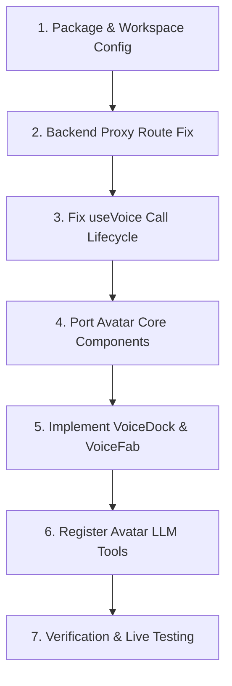

# Persona Voice Agent Remediation & Avatar Upgrade Plan

> **Target Repository**: `D:\persona-nextjs-starter`  
> **Reference Architecture**: `D:\agent-marketplace\platform` & `D:\agent-marketplace\sdk\avatar`  
> **Output Artifact**: `persona-avatar-plan.md` & `docs/persona-avatar-plan.md`

---

## 1. Executive Summary & Root Cause Analysis

### Why Voice Is Currently Failing in `persona-nextjs-starter`

Based on technical diagnostics across the frontend hook lifecycle, proxy endpoints, and package manifests, the voice agent is failing due to three primary root causes:

#### Root Cause 1: Loss of Browser User Activation Context (Microphone Permission Block)
- **Location**: `components/persona/chat-sdk/use-persona-chat-widget.ts` (lines 126–152).
- **The Issue**: When `startVoice()` is clicked from a clean state (`/`), the hook executes:
  ```typescript
  const thread = await createThread(agentId);
  setActiveThreadId(thread.id);
  pendingVoiceStartRef.current = true;
  ```
  It then defers `voice.start()` to a `useEffect` watching `activeThreadId`.
- **The Impact**: In modern browsers (Chrome, Safari, Edge, Firefox), `navigator.mediaDevices.getUserMedia()` and Web Audio `AudioContext.resume()` strictly require **transient user activation** (an immediate synchronous call inside a user click event). Delegating `voice.start()` to an asynchronous `useEffect` across a promise tick strips the user gesture context, causing the browser to reject microphone access or block audio playback without showing a permission dialog.
- **Platform Reference**: In `D:\agent-marketplace\platform\src\components\persona\chat-sdk\voice-fab.tsx`:
  ```typescript
  // Synchronous execution under direct user gesture:
  const handleStart = React.useCallback(() => {
    void voice.start();
  }, [voice]);
  ```
  Thread minting runs concurrently in the background without blocking audio startup.

#### Root Cause 2: Proxy Route Subpath Alignment (`mountPath`) & Clerk Middleware Interception
- **Locations**: `app/api/persona/[...persona]/route.ts` and `proxy.ts`.
- **The Issues**:
  1. `createPersonaHandler` is initialized without `mountPath: "/api/persona"` and without `export const dynamic = "force-dynamic"`. In Next.js 16 (Turbopack), `stripMountPath` fails to trim `/api/persona`, so route matching against `["voice", "sessions"]` fails with `404 NOT_FOUND: No route for POST /api/persona/voice/sessions`.
  2. `/api/persona` is missing from `PUBLIC_PREFIXES` in `proxy.ts`. When an unauthenticated visitor accesses voice (e.g., on `/assistant`), Clerk Middleware issues an HTTP 307 redirect to `/sign-in` (HTML) instead of allowing the adapter to return JSON, causing `SyntaxError: Unexpected token '<', "<!DOCTYPE "... is not valid JSON`.
  3. `resolveUserFrom` returns `null` for unauthenticated sessions. The Persona runtime requires an asserted subject for voice tickets and returns `401 Unauthorized`.
- **Platform Reference**: `platform/src/app/api/persona/[...persona]/route.ts` uses an anonymous visitor cookie fallback (`visitorId`) and declares `mountPath: "/api/persona"` with `dynamic = "force-dynamic"`.

#### Root Cause 3: Outdated `@personaai/react` Pin (`useEffect` Teardown Bug) & Missing `@personaai/avatar`
- **Location**: `pnpm-workspace.yaml` and `package.json`.
- **The Issue**:
  - `pnpm-workspace.yaml` pins `@personaai/react` to `0.31.0`. Version `0.31.0` has a known bug in `useVoice`: `useEffect(() => stop, [stop])` runs on re-render when `stop`'s dependencies change, aborting WebSocket connections prematurely with `client_stop` (fixed in `0.31.7` via ref-backed unmount teardown).
  - `@personaai/avatar` is completely missing from `package.json`.
  - The voice UI currently only renders an `<Orb>` from `orb-ui`, lacking SVG rigs, lip-sync phonemes, and gesture tools.

---

## 2. Step-by-Step Remediation & Upgrade Plan



---

### Phase 1: Package & Workspace Upgrades

#### 1.1 Update `pnpm-workspace.yaml`
1. Update `@personaai/react` override from `0.31.0` to `0.31.7`.
2. Add `@personaai/avatar@0.3.1` to `minimumReleaseAgeExclude`:
```yaml
overrides:
  '@personaai/react': '0.31.7'

minimumReleaseAgeExclude:
  - '@personaai/avatar@0.3.1'
  - '@personaai/react@0.31.7'
```

#### 1.2 Install `@personaai/avatar`
Add `@personaai/avatar@^0.3.1` to `package.json` dependencies:
```bash
pnpm add @personaai/avatar@^0.3.1
```

---

### Phase 2: Backend Proxy Fix (`app/api/persona/[...persona]/route.ts`)

Update the route handler to ensure proper route mounting and prevent static generation caching:
```typescript
import { auth } from "@clerk/nextjs/server";
import { createPersonaHandler } from "@personaai/adapters/nextjs/server";

const personaHandler = createPersonaHandler({
  baseUrl: process.env.PERSONA_BASE_URL!,
  credential: process.env.PERSONA_CREDENTIAL!,
  mountPath: "/api/persona",
  resolveUserFrom: async () => {
    const { userId } = await auth();
    return userId ?? null;
  },
  forwardTraceparent: true,
  defaultEnvironment: "production",
  allowClientVersionSelection: true,
  selectVersion: async () => {
    return { environment: "production" };
  },
  capabilities: {
    messages: true,
  },
  logLevel: process.env.NODE_ENV === "production" ? "info" : "debug",
  mode: process.env.NODE_ENV === "production" ? "production" : "development",
});

export const { GET, POST, PUT, PATCH, DELETE } = personaHandler;
export const dynamic = "force-dynamic";
```

---

### Phase 3: Core Voice Hook Lifecycle Fix (`use-persona-chat-widget.ts`)

#### 3.1 Eliminate Deferred `useEffect` Audio Startup
Replace the asynchronous thread creation waterfall with immediate, synchronous `voice.start()`:
```typescript
// Enable autoPrefetch for fast ticket initialization:
const voice = useVoice({
  agentId: effectiveVoiceAgentId,
  threadId: activeThreadId,
  autoPrefetch: true,
});

// Synchronous click handler:
const startVoice = React.useCallback(() => {
  // 1. Immediately invoke voice.start() within user activation window
  void voice.start();

  // 2. Background thread persistence if needed (non-blocking)
  if (!activeThreadId) {
    createThread(agentId).then((newThread) => {
      setActiveThreadId(newThread.id);
    }).catch(console.error);
  }
}, [voice, activeThreadId, agentId, createThread]);
```

---

### Phase 4: Port Avatar Components from Platform

Create the following files in `components/persona/avatar/` using the reference code from `D:\agent-marketplace\platform\src\components\persona\avatar\`:

#### 4.1 `components/persona/avatar/avatar-slot.tsx`
Provides the `AvatarSlotProvider` and `useSlottedAvatar()` context so deeply nested avatar components can publish their `Avatar` instance to tool registries anywhere in the app shell.

#### 4.2 `components/persona/avatar/anime-voice-avatar.tsx`
Implements `AnimeVoiceAvatar` wrapping `@personaai/avatar`'s `sakura` (and optional custom rigs like `scarlet`):
- Connects `useVoiceAvatar(voice, { pack })`.
- Handles cursor gaze tracking via `pointermove` (`avatar.lookAt({ x, y })`).
- Binds partial transcript text to phonetic viseme swaps (`voice.partial?.text`).
- Supports voice state resting expressions (`listening`, `thinking`, `speaking`, `idle`).

#### 4.3 `components/persona/avatar/index.ts`
Barrel export file:
```typescript
export * from "./anime-voice-avatar";
export * from "./avatar-slot";
```

---

### Phase 5: Implement `VoiceDock` & `VoiceFab` Components

Port the interactive floating call dock and launcher from `D:\agent-marketplace\platform\src\components\persona\chat-sdk\`:

#### 5.1 `components/persona/chat-sdk/voice-dock.tsx`
- **Portalled Layout**: Renders into `document.body` with `fixed right-4 bottom-4 z-50`.
- **Circular Avatar**: Circular masked avatar (`rounded-full bg-card shadow-xl overflow-hidden`) with shoulder correction `transform: translateY(10.5%) scale(1.35)`.
- **Dynamic State Rings**:
  - Listening: `ring-foreground/40`
  - Speaking: `ring-foreground`
  - Thinking: `ring-foreground/60 animate-pulse`
  - Muted: `ring-destructive/60`
- **Peripheral Badges**:
  - Bottom-left: Mic mute/unmute.
  - Bottom-right: Hang-up button executing `endWithGoodbye` (~1.9s wave animation before disconnecting).
  - Top-right: Expand to full chat panel.
- **Vanishing Speech Bubbles**: Real-time transcript caption that automatically fades out 4.5 seconds after speech ends.

#### 5.2 `components/persona/chat-sdk/voice-fab.tsx`
Floating 64px circular trigger button with avatar preview for single-tap instant calling.

#### 5.3 `components/persona/chat-sdk/voice-indicator.tsx`
Update to support dual-mode rendering:
```tsx
export function VoiceIndicator({
  voice,
  variant = "avatar",
  size = 200,
  pack,
}: VoiceIndicatorProps) {
  if (variant === "avatar" && size >= 60) {
    return <AnimeVoiceAvatar voice={voice} size={size} pack={pack} />;
  }
  return <Orb size={size} state={voice.state} volume={voice.volume} />;
}
```

---

### Phase 6: Register Avatar LLM Tools (`frontend-tools.tsx`)

Enable the voice model to express emotions and gestures during the call:
1. In `components/dostify/app-shell.tsx` and `app/assistant/assistant-experience.tsx`, wrap the application in `<AvatarSlotProvider>`.
2. In `components/persona/chat-sdk/frontend-tools.tsx`:
   ```typescript
   import { useAvatarTools } from "@personaai/avatar/persona";
   import { useSlottedAvatar } from "@/components/persona/avatar";

   export function PersonaFrontendTools() {
     // Exposes set_avatar_emotion and trigger_avatar_reaction to the model:
     useAvatarTools(useSlottedAvatar());

     // Existing tools (navigation, theme, charts, etc.)...
     return null;
   }
   ```

---

## 3. Verification & Testing Matrix

| Test Case | Expected Result | Pass Criteria |
| :--- | :--- | :--- |
| **1. TypeScript Compilation** | Run `pnpm exec tsc --noEmit` | 0 errors across all avatar and voice files. |
| **2. Instant Call Startup** | Click Voice Call from `/` (new chat) | Microphone prompt appears immediately with zero console audio context warnings. |
| **3. Voice Streaming** | Speak into microphone | WebSocket connects to `/api/v1/developer/voice`; audio frames stream in 16 kHz / 24 kHz PCM. |
| **4. Viseme Lip-Sync** | Agent responds with speech | Avatar mouth morphs through phonemes (`A, I, U, E, O, M, S`) synchronized with audio volume. |
| **5. Agent Emotes & Gestures** | Model triggers `trigger_avatar_reaction` | Avatar waves, nods, or bows on screen in response to LLM tool calls. |
| **6. Graceful Goodbye** | Click End Call | Avatar waves/bows for ~1.9s while microphone stays open, then terminates cleanly. |

---

## 4. Execution Roadmap

- [ ] **Step 1**: Update `pnpm-workspace.yaml` and install `@personaai/avatar@^0.3.1`.
- [ ] **Step 2**: Add `mountPath: "/api/persona"` and `dynamic = "force-dynamic"` to `app/api/persona/[...persona]/route.ts`.
- [ ] **Step 3**: Refactor `use-persona-chat-widget.ts` to trigger `voice.start()` synchronously.
- [ ] **Step 4**: Copy and integrate avatar components (`avatar-slot.tsx`, `anime-voice-avatar.tsx`, `index.ts`).
- [ ] **Step 5**: Upgrade `voice-dock.tsx`, `voice-fab.tsx`, and `voice-indicator.tsx`.
- [ ] **Step 6**: Wire `useAvatarTools(useSlottedAvatar())` into frontend tools.
- [ ] **Step 7**: Test live audio and avatar animations in dev environment (`pnpm dev`).
